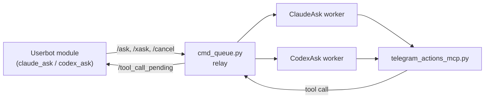

# Telegram AI Core

> Part of **[Telegram AI](https://github.com/maleon17/telegram-ai)** — Claude/Codex from dedicated bots or directly inside your Telegram account.

The shared foundation of **[ClaudeAsk](https://github.com/maleon17/claude-ask)** and **[CodexAsk](https://github.com/maleon17/codex-ask)**. You normally do not install it by hand: each product's `setup.sh` finds this repository next to its own checkout, or clones it there, and runs what it needs.

It exists so that either product can be installed on its own. Before, each of the two needed a file that lived only in the other.

## What is here

| Piece | File | Role |
|---|---|---|
| Queue relay | `cmd_queue.py` | Authenticated HTTP relay between the userbot and the backend workers |
| Telegram actions | `telegram_actions_mcp.py` | MCP server: real Telegram actions, executed by the userbot that holds the session |
| Userbot modules | `module/` | One template, built into `claude_ask.py` and `codex_ask.py`; plus the `jarvis_ask.py` coordinator |
| Registry | `registry.py` | Which components are installed on this host, and where |
| Installers | `install_relay.sh`, `register_instance.sh` | Idempotent, non-interactive; used by the product setup scripts |
| Userbot host | `deploy/userbot/`, `scripts/setup_userbot_network.sh` | Local Docker userbot, or Tailscale for a remote one |



The backend never owns the Telegram account. A Telegram action is queued back to the module that holds the live session, and the agent sees the real result before it can claim the action happened.

## The component registry

`~/.config/telegram-ai/registry.json` (override the directory with `TELEGRAM_AI_CONFIG_DIR`):

```json
{
  "version": 1,
  "components": {
    "core":          {"path": "/home/me/telegram-ai-core", "python": "…/.venv/bin/python"},
    "relay":         {"path": "…", "unit": "jarvis-ask-cmd-queue.service", "url": "http://127.0.0.1:9092",
                      "config_dir": "…", "state_dir": "…"},
    "claude-ask":    {"path": "…", "unit": "…", "persona_dir": "…", "owner_name": "…", "owner_tg_id": "…"},
    "codex-ask":     {"path": "…", "unit": "…", "persona_dir": "…"},
    "claude-bridge": {"path": "…", "unit": "…"},
    "codex-bridge":  {"path": "…", "unit": "…"}
  }
}
```

Every component writes its own entry when its `setup.sh` runs and looks its neighbours up here instead of guessing directory names. The file format is the contract: it is simple enough that the two bridges, which do not depend on this repository, read and write it with a few lines of their own. An entry whose `path` no longer exists is treated as absent.

```bash
.venv/bin/python registry.py list
.venv/bin/python registry.py get relay url
.venv/bin/python registry.py register claude-bridge path=/srv/claude-telegram-bridge
```

## Relay authentication

Two small maps live in the configuration directory (`~/.config/telegram-ai/`), mode `0600`, owned by the user the relay runs as:

- `relay-tokens.json` — `sha256(token)` → `instance_id`; the token itself is never stored
- `relay-owners.json` — `instance_id` → Telegram owner ID

No `sudo` is involved in managing them, and the running relay notices an edit by itself: adding an instance does not restart it or drop requests in flight.

```bash
./register_instance.sh mybot 123456789                      # prints the new token once
.venv/bin/python cmd_queue.py --list                        # instances, owners, token counts
.venv/bin/python cmd_queue.py --revoke-tokens mybot         # invalidates every token of that instance
```

Each worker keeps its own token in `relay-token-claude.env` / `relay-token-codex.env` there, so installing one product never overwrites the other's credentials.

The authenticated userbot reports who sent a request. The relay cannot prove the original Telegram sender itself, so the userbot is an explicit trust boundary; owner authorisation is nevertheless derived server-side from the token's instance, and a client cannot simply claim to be the owner. Requests, tool calls, results, personas, resets, cancellations and downloadable artifacts are all scoped by instance.

Runtime state (queues, uploads, request manifests) lives in `~/.local/state/telegram-ai` (`JARVIS_STATE_DIR`), mode `0700` — never `/tmp`, because it carries chat text and media. The relay and every worker on a host must share that directory.

## Installing the relay by hand

```bash
git clone https://github.com/maleon17/telegram-ai-core.git
cd telegram-ai-core
./install_relay.sh                       # virtualenv, systemd unit, registry entries
./register_instance.sh mybot 123456789   # first instance; this also starts the relay
```

`install_relay.sh` leaves a relay that is already running untouched. `JARVIS_RELAY_BIND` (default `127.0.0.1`) and `JARVIS_QUEUE_PORT` (default `9092`) can be set in `~/.config/telegram-ai/relay.env`.

## The userbot modules

`module/ask_module.py.tmpl` is the single source of both modules. They differ only in names (module, commands, relay endpoints) and a few backend-specific lines:

```bash
python3 module/build.py            # writes module/dist/claude_ask.py and codex_ask.py
python3 module/build.py --check    # fails if dist/ is stale (CI runs this)
python3 module/build.py --install  # also copies each module into its product checkout
```

Never edit the generated files — in `dist/` or in the product repositories — change the template and rebuild.

Module commands (CodexAsk uses the `x` prefix: `.xask`, `.xstop`, …):

| Command | What it does |
|---|---|
| `.ask <question>` | Ask; the message is edited in place with live progress, then the answer |
| `.search <word>`, `.translate <text>` | Search the chat and answer; translate |
| `.stop` | Stop the request in this chat (as a reply to its message: only that one) |
| `.new` | Start a fresh session |
| `.persona` | View or replace the persona |
| `.asknet …` | Set up the connection to the backend; `.asknet check` verifies it |

Settings are stored in the module config, so `.cfg ClaudeAsk` / `.cfg CodexAsk` edits the same values that `.asknet` sets.

## Tests

```bash
./scripts/run_tests.sh
```

Covers the relay, the registry, the MCP server and both built modules. Nothing in the suite needs Telegram, a Claude or Codex login, or a live relay.

## License

MIT, see [LICENSE](LICENSE). The userbot modules load into [Heroku](https://github.com/coddrago/Heroku), which is AGPLv3; the module files carry that notice.
